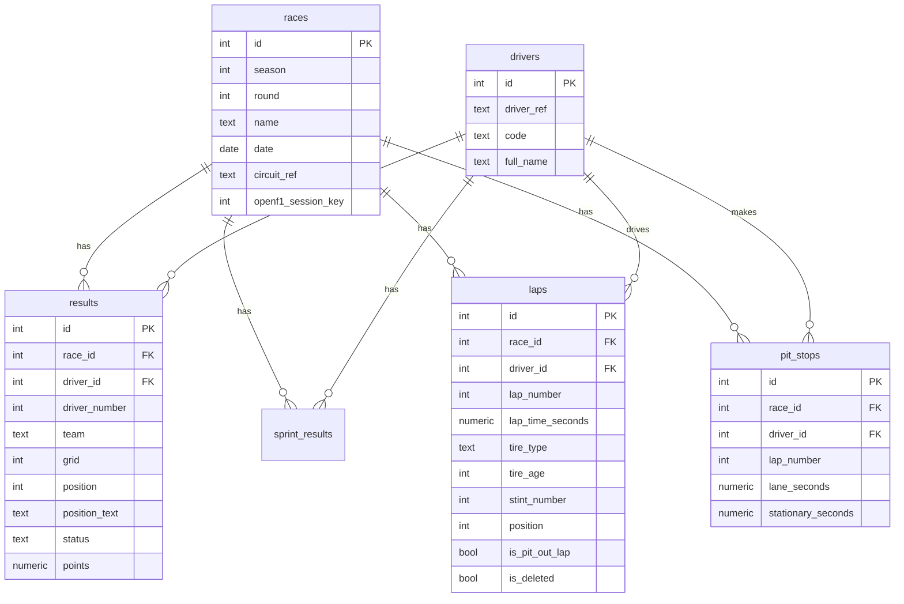

# Database schema

Six tables, one per kind of thing, linked by ID numbers. Each lap row stores the ID of its race and the ID of its driver.

Results and race details come from [Jolpica](https://api.jolpi.ca/ergast/). Lap-level data comes from [OpenF1](https://openf1.org/). The two sources identify races and drivers differently, so `races.openf1_session_key` and `results.driver_number` link them.

## Tables

### races

One row per race. Unique on `season` + `round`.

| Column | Source | Notes |
|---|---|---|
| `id` | generated | Primary key |
| `season` | Jolpica | |
| `round` | Jolpica | |
| `name` | Jolpica | For example "Italian Grand Prix" |
| `date` | Jolpica | |
| `circuit_ref` | Jolpica `circuitId` | For example `monza`. The race name alone can't answer "Who won Monza 2023?" |
| `openf1_session_key` | OpenF1 | Unique, nullable. Null before 2023 |

### drivers

One row per driver. Unique on `driver_ref`.

| Column | Source | Notes |
|---|---|---|
| `id` | generated | Primary key |
| `driver_ref` | Jolpica `driverId` | For example `max_verstappen` |
| `code` | Jolpica | Nullable and not unique. Some older results have no code, and codes can be reused |
| `full_name` | Jolpica | |

Car numbers are not stored here because they change over time. NOR is #1 in 2026.

### results

One row per driver per race. Unique on `race_id` + `driver_id`. This is the official outcome, because lap positions alone can't show who won after retirements and penalties.

| Column | Source | Notes |
|---|---|---|
| `id` | generated | Primary key |
| `race_id` | | Foreign key to `races` |
| `driver_id` | | Foreign key to `drivers` |
| `driver_number` | Jolpica | The link to OpenF1, which only identifies drivers by car number |
| `team` | Jolpica | Text. Stored per race because drivers change teams |
| `grid` | Jolpica | Starting position |
| `position` | Jolpica | Numeric order only. Read it with `position_text` |
| `position_text` | Jolpica | For example `1`, `R` or `W`. A driver who didn't start can still have a `position` of 20 |
| `status` | Jolpica | For example Finished, Lapped or Retired |
| `points` | Jolpica | NUMERIC, because the 2021 Belgian GP paid 12.5 |

### sprint_results

One row per driver per sprint. Unique on `race_id` + `driver_id`, with an index on `driver_id`. Same columns and sources as `results`, loaded from Jolpica `/sprint/`. Only races with a sprint have rows.

### laps

One row per lap per driver. Unique on `race_id` + `driver_id` + `lap_number`.

| Column | Source | Notes |
|---|---|---|
| `id` | generated | Primary key |
| `race_id` | | Foreign key to `races` |
| `driver_id` | | Foreign key to `drivers` |
| `lap_number` | OpenF1 `laps` | |
| `lap_time_seconds` | OpenF1 `laps` | NUMERIC, nullable. Some laps have no recorded time |
| `tire_type` | OpenF1 `stints` | Joined on lap range. Nullable |
| `tire_age` | OpenF1 `stints` | `tyre_age_at_start + (lap_number - lap_start)`. Nullable |
| `stint_number` | OpenF1 `stints` | Nullable |
| `position` | OpenF1 `position` | Derived from a time series. Nullable |
| `is_pit_out_lap` | OpenF1 `laps` | Excludes out-laps from pace analysis |
| `is_deleted` | OpenF1 `race_control` | Parsed from message text such as `CAR 5 (BOR) TIME 1:53.937 DELETED - TRACK LIMITS AT TURN 11 LAP 2`. The lap and car come from the text, not the row's fields |

### pit_stops

One row per stop. Unique on `race_id` + `driver_id` + `lap_number`.

| Column | Source | Notes |
|---|---|---|
| `id` | generated | Primary key |
| `race_id` | | Foreign key to `races` |
| `driver_id` | | Foreign key to `drivers` |
| `lap_number` | OpenF1 `pit` | |
| `lane_seconds` | OpenF1 `lane_duration` | Time in the pit lane, for example 25.76. Don't use `pit_duration`, which is deprecated |
| `stationary_seconds` | OpenF1 `stop_duration` | Time stopped, for example 4.4. Nullable, available from the 2024 US GP |

## Rules

- Foreign keys are NOT NULL.
- `results`, `laps` and `pit_stops` each get an index on `driver_id`. Their unique constraints already cover lookups by race.
- Older races have `results` rows but no `laps` rows. This lets Jolpica history go back further than OpenF1's 2023 start.

## Decisions

- **Race matching:** link OpenF1 sessions to Jolpica rounds by year and UTC date, not time. Start times can differ between sources: Miami 2026 is 17:00Z in OpenF1 and 20:00Z in Jolpica.
- **Reloads:** unique constraints stop duplicates, but the loader should upsert rather than fail, so post-race penalties update existing rows.
- **Pit stop coverage:** OpenF1 has no pit data before the 2023 Spanish GP (round 7). Rounds 1 to 6 of 2023 have `laps` rows but no `pit_stops` rows. Observed on 2026-10-30, not stated in the OpenF1 docs.
- **History starts at 2000:** this covers the full career of every driver on the current grid (Alonso, the longest-serving, debuted in 2001). Drivers who raced before 2000 have partial career stats, for example Michael Schumacher shows 56 wins instead of 91. Loading earlier seasons needs no schema change: `uv run python load_data.py 1950 ... 1999`. Expect some loader fixes for old data.
- **Current season is cached:** `load_data.py` caches every response by URL forever, so rerunning it won't pick up races held since the last load. Delete the `cache/` files for the current season first.
- **Sprints:** stored in their own `sprint_results` table (Jolpica `/sprint/`, 2021 onward), because they don't fit the one-row-per-driver-per-race rule on `results`. Same columns as `results`. Driver stats add sprint points to race points, but `races` and `wins` count Grands Prix only. Laps and pit stops are still Grand Prix only.
- **OpenF1 outages:** free access returns 401 for all data, including past races, while any F1 session is live. The weekly job must run outside sessions and treat a 401 as retry-later. The site is unaffected because it reads from our own database.
- **No teams table yet:** `results.team` is plain text until an analysis needs more.

## Verification status

Not yet checked, because OpenF1 was locked by a live session when this was written:

- [ ] No two pit rows share race, driver and lap in the 2026 US GP
- [ ] Every 2023-2026 OpenF1 race matches exactly one Jolpica round by UTC date
 